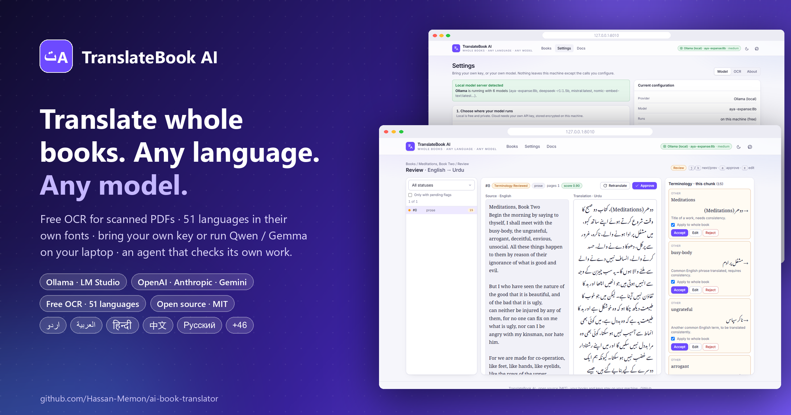
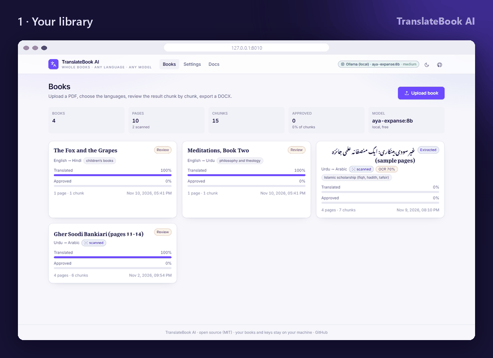
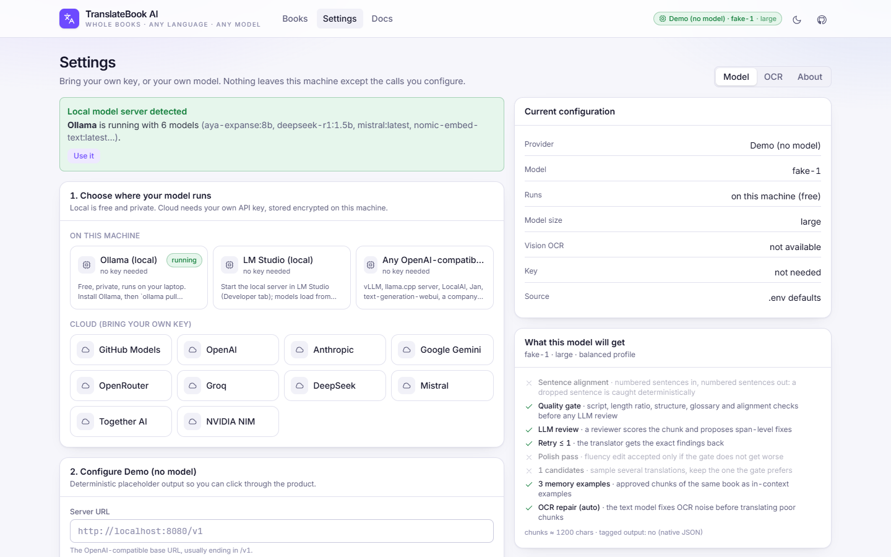
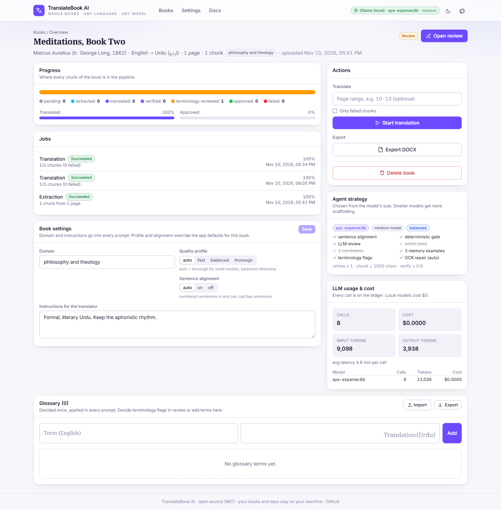
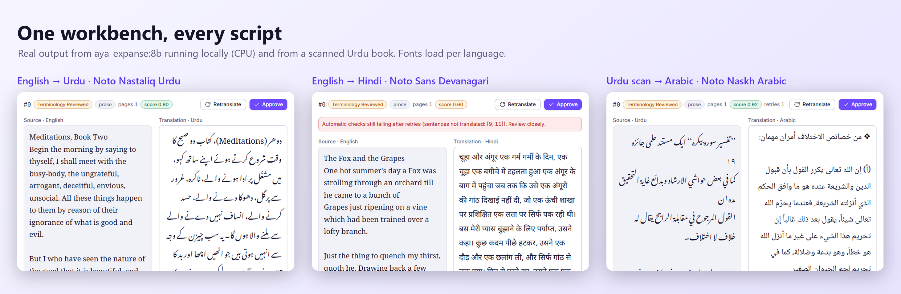
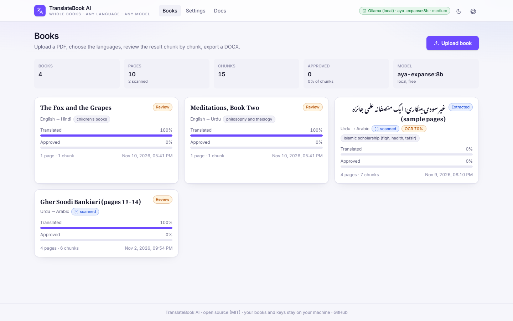
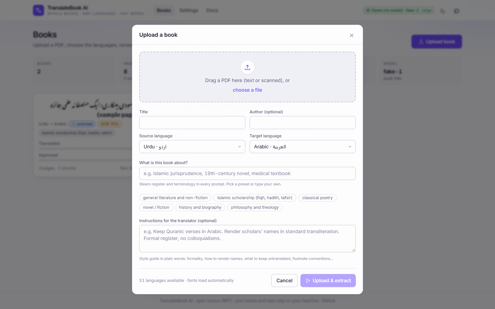
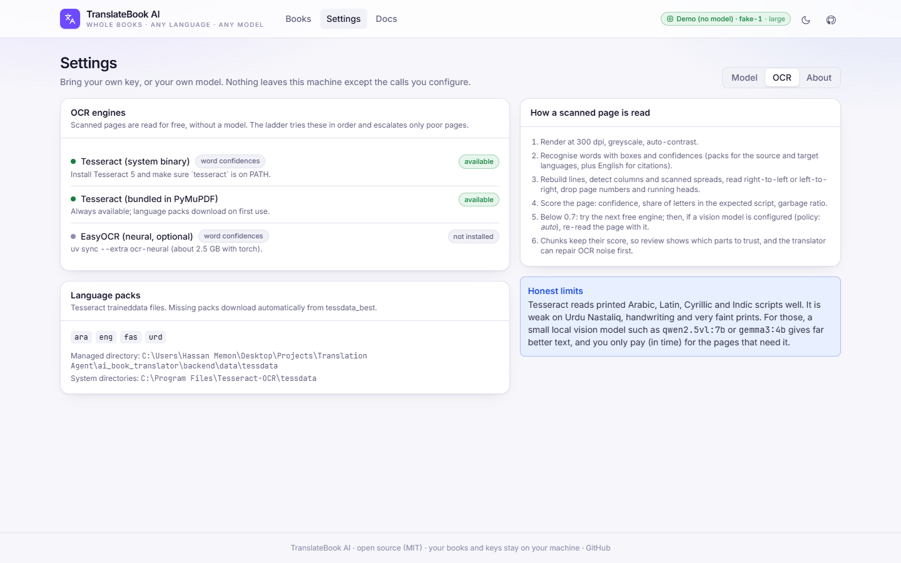
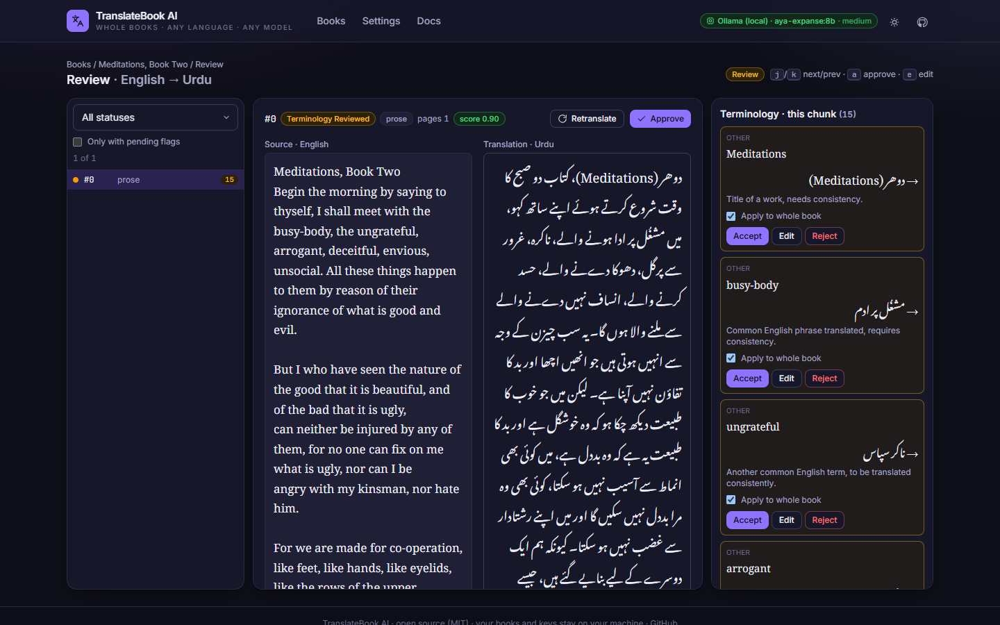
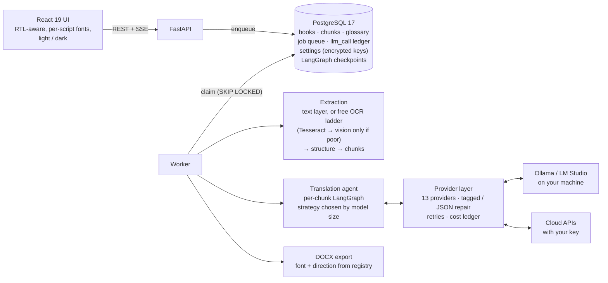

<div align="center">


# TranslateBook AI

### Translate whole books, not paragraphs. Any of 51 languages. Any model, including one on your own laptop.

Free OCR for scanned PDFs · bring your own API key or run Ollama locally · an agent that checks and retries its own work · terminology decided once for the whole book · a review screen built for the script · DOCX export

[](https://github.com/Hassan-Memon/ai-book-translator/actions/workflows/ci.yml)
[](https://python.org)
[](https://fastapi.tiangolo.com)
[](https://langchain-ai.github.io/langgraph/)
[](https://postgresql.org)
[](https://react.dev)
[](https://ollama.com)
[](LICENSE)



<br>



<sub>A 20-second tour. Every screen shows real output: two books translated by <code>aya-expanse:8b</code> running on a CPU-only laptop, and a scanned Urdu book read by the free OCR.</sub>

</div>

---

## What it does

You upload a PDF. It can be a clean digital book or a 400-page scan from a library. TranslateBook AI:

1. **Reads it without any AI model.** Text-layer PDFs are read directly. Scanned pages go through a free OCR ladder built on Tesseract: 300 dpi render, layout reconstruction, column and two-page-spread detection, right-to-left reading order, page-number removal and a quality score for every page. → [docs/OCR.md](docs/OCR.md)
2. **Cuts it into structure-aware chunks.** A heading always starts a chunk. Footnotes, verses and lists keep their type.
3. **Translates every chunk with an agent that checks its own work.** Deterministic checks catch a skipped sentence, the wrong script or a chat preamble at no cost. An LLM reviewer then proposes span-level fixes, and the translator retries with the exact findings. → [docs/AGENT_STRATEGY.md](docs/AGENT_STRATEGY.md)
4. **Keeps terminology consistent.** Terms that need a human decision are flagged once. *Apply to whole book* writes the glossary that goes into every later prompt.
5. **Puts you in charge.** Side-by-side review in the right font and direction, keyboard-driven, with accept or reject on every suggestion.
6. **Exports DOCX** with headings, right-to-left paragraphs and a Noto font chosen for the target script.

## Bring your own model

<table>
<tr>
<td width="50%"></td>
<td width="50%"></td>
</tr>
<tr>
<td><sub><b>Settings.</b> Pick where the model runs. A running Ollama is detected automatically. Keys are encrypted on your machine.</sub></td>
<td><sub><b>Book overview.</b> Progress, live jobs, the strategy the agent will use for this model, and every LLM call with its cost.</sub></td>
</tr>
</table>

| Where it runs | Providers | Cost |
|---|---|---|
| **On your laptop** | Ollama, LM Studio, any OpenAI-compatible server (vLLM, llama.cpp, LocalAI, Jan) | $0, nothing leaves your machine |
| **Your own cloud key** | OpenAI, Anthropic, Google Gemini, OpenRouter, Groq, DeepSeek, Mistral, Together AI, NVIDIA NIM, GitHub Models | You pay the provider directly |
| **No model at all** | Demo mode | Placeholder translations, so you can click through the product |

Paste a key in **Settings**, press **Test connection** and save. No `.env` editing is needed. Keys are stored encrypted with Fernet and never sent back to the browser. → [docs/CONFIGURATION.md](docs/CONFIGURATION.md)

### Small models that run on a laptop

| Model | Size | RAM | Good for |
|---|---|---|---|
| `qwen3:8b` | 8B | ~8 GB | **Recommended.** The best all-round translator for a 16 GB laptop, 119 languages |
| `qwen3:4b` | 4B | ~5 GB | 8 GB laptops. Surprisingly strong once sentence alignment is on |
| `gemma3:12b` | 12B | ~10 GB | Highest quality that still fits in 16 GB. It can also read scanned pages |
| `gemma3:4b` | 4B | ~5 GB | Translation and vision OCR in one 3 GB download |
| `aya-expanse:8b` | 8B | ~8 GB | Cohere's multilingual model, with a strong Arabic register |
| `qwen2.5vl:7b` | 7B | ~8 GB | The best free OCR for scripts Tesseract struggles with, such as Nastaliq |

```bash
ollama pull qwen3:8b        # translator
ollama pull qwen2.5vl:7b    # optional: vision OCR for hard scans
```

Full guide, including hardware sizing and what to expect per chunk on a CPU: [docs/LOCAL_MODELS.md](docs/LOCAL_MODELS.md).

## The agent: how a 4B model stays on track

Small models rarely fail at translating a sentence. They fail at following instructions across 1,500 characters. They skip a sentence, answer in English, add "Here is the translation:", or break the JSON. Each step below is a cheap countermeasure for one of those failures. The scaffolding is chosen automatically from the model's size:

```
prepare ─► OCR repair? ─► translate ─► quality gate ─┬─ fail ─► retry with the exact findings ─┐
                              ▲                       └─ pass ─► LLM review ─┬─ low score ─────────┤
                              │                                              └─ ok ─► polish? ─► terminology ─► END
                              └──────────────────────────────────────────────────────────────────┘
```

| Technique | What it catches | Small | Medium | Large |
|---|---|:-:|:-:|:-:|
| **Sentence alignment**: numbered sentences in, numbered out | A dropped sentence becomes a set difference, not a judgement | ✓ | ✓ | |
| **Tagged output** (`<translation>`) instead of JSON | Broken JSON around long right-to-left text | ✓ | ✓ | |
| **Quality gate**: script, length ratio, structure, glossary | Wrong language, copied source, omissions, lost list items | ✓ | ✓ | ✓ |
| **LLM review** with span-level fixes and a retry | Meaning errors, terminology drift | ✓ | ✓ | ✓ |
| **Several candidates**, keep the one the gate prefers | Unlucky samples (free on a local model) | ✓ | | |
| **Polish pass**, kept only if the gate does not get worse | Stiff, literal phrasing | ✓ | | |
| **Translation memory**: approved chunks as examples | Style and terminology drift across the book | ✓ | ✓ | ✓ |
| **Smaller chunks** (700 / 1,000 / 1,200 chars) | Attention running out | ✓ | ✓ | |
| **OCR repair** before translating noisy scans | Translating OCR garbage literally | ✓ | ✓ | ✓ |

You can override any of this per book (fast, balanced or thorough). Details and the reasoning behind each step: [docs/AGENT_STRATEGY.md](docs/AGENT_STRATEGY.md).

## 51 languages, each in its own font

Every language is one row in a registry ([`core/languages.py`](backend/app/core/languages.py)) that drives the whole product. The row sets the script, the direction, the Tesseract pack, the sentence terminators, the font for the UI and the DOCX, and the line height. Fonts load on demand, so an Urdu book renders in **Noto Nastaliq Urdu**, Arabic in **Noto Naskh Arabic**, Hindi in **Noto Sans Devanagari**, and Chinese in **Noto Sans SC**.



Arabic, Urdu, Persian, Pashto, Sindhi, Uyghur, Kurdish, Hebrew, English, French, German, Spanish, Portuguese, Italian, Dutch, Turkish, Indonesian, Malay, Swahili, Polish, Vietnamese, Somali, Hausa, Uzbek, Azerbaijani, Russian, Ukrainian, Kazakh, Greek, Hindi, Marathi, Nepali, Sanskrit, Bengali, Punjabi, Gujarati, Tamil, Telugu, Kannada, Malayalam, Sinhala, Chinese (Simplified and Traditional), Japanese, Korean, Thai, Burmese, Khmer, Amharic, Armenian and Georgian. Adding one is a single line: [docs/LANGUAGES.md](docs/LANGUAGES.md).

## Screenshots

<table>
<tr>
<td width="50%"></td>
<td width="50%"></td>
</tr>
<tr>
<td><sub><b>Library.</b> Every book with its languages, scan status, OCR quality and progress.</sub></td>
<td><sub><b>Upload.</b> The first pages are inspected before upload: page count, scan or text, and the detected language. Domain presets and a style guide steer every prompt.</sub></td>
</tr>
<tr>
<td></td>
<td></td>
</tr>
<tr>
<td><sub><b>OCR status.</b> Available engines, installed language packs, and what happens to a scanned page.</sub></td>
<td><sub><b>Dark mode</b> follows your OS until you choose.</sub></td>
</tr>
</table>

## Run it in 3 minutes

You need Python 3.12+, [uv](https://docs.astral.sh/uv/), Node 22+ and Docker. [Tesseract 5](https://tesseract-ocr.github.io/tessdoc/Installation.html) is recommended because it gives the OCR word confidences, but it is optional. **No API key is needed to start.**

```bash
git clone https://github.com/Hassan-Memon/ai-book-translator.git
cd ai-book-translator
make setup     # first time: .env, Postgres in Docker, dependencies, UI build, migrations
make start     # every time: start Postgres, migrate, run the app
```

Open **http://127.0.0.1:8010**, go to **Settings**, and connect a model. If Ollama is running, the app finds it on its own.

`make test` runs the tests · `make lint` runs the linters · `make help` lists every command · `make up` runs everything in Docker, with Tesseract included in the image.

<details>
<summary>Without make</summary>

```bash
cp .env.example .env
docker compose up -d --wait db    # Postgres on localhost:5433

cd frontend && npm install && npm run build && cd ..
cd backend
uv sync
uv run alembic upgrade head
uv run uvicorn app.main:app --port 8010 --loop app.core.eventloop:new_event_loop
```
</details>

<details>
<summary>Troubleshooting</summary>

- **`docker compose` can't connect**: start Docker Desktop first.
- **"No text could be extracted"** on a scan: no OCR engine was usable. Install Tesseract, or leave `OCR_DOWNLOAD_PACKS=true` so the PyMuPDF engine can fetch its language packs, or configure a vision-capable model.
- **OCR quality is low on Urdu**: Tesseract is weak on Nastaliq. Set a vision model such as `qwen2.5vl:7b` in Settings and re-upload, so poor pages escalate to it. See [docs/OCR.md](docs/OCR.md).
- **Ollama "not reachable"**: run `ollama serve`, then check the URL in Settings (default `http://localhost:11434`).
- **Local model is slow**: on a CPU expect minutes per chunk. Use `qwen3:4b`, set `TRANSLATION_CONCURRENCY=1`, or choose the *fast* profile for the book.
- **Port 5433 in use**: set `DB_PORT=5434` and update both database URLs in `.env`.
- **Windows event-loop error**: keep `--loop app.core.eventloop:new_event_loop` (the Makefile does).
</details>

### Put it online for free (Cloudflare)

The web app runs on Cloudflare Pages behind a password. The heavy work (OCR, database, your local model) stays on your machine, reached through a free Cloudflare Tunnel with a shared secret. Hosting costs nothing, and books and keys never leave your machine.

```bash
python deploy/cloudflare/connect.py setup   # once: Pages project, secrets, first deploy
python deploy/cloudflare/connect.py         # each session, while `make start` runs
```

See [docs/CLOUDFLARE.md](docs/CLOUDFLARE.md) for the security model, a stable address with your own domain, and the free-tier limits.

## Under the hood



- **Crash-safe.** The job queue is a Postgres table (`FOR UPDATE SKIP LOCKED`, heartbeats, backoff). LangGraph checkpoints every node. [`test_kill_resume.py`](backend/tests/test_kill_resume.py) hard-kills a real worker in the middle of a chunk, and the next worker resumes at that exact node without paying for the translation twice. [ADR-0002](docs/adr/0002-postgres-as-job-queue.md)
- **Every LLM call is on a ledger** with node, model, prompt version, tokens, latency and cost. Local models cost $0.
- **Prompts are versioned markdown** with changelogs in [`prompts/`](prompts/).
- **Live progress** arrives over Server-Sent Events.
- **68 tests, 83% coverage**, on a real Postgres in CI: the kill-resume test, the full review workflow over HTTP, the small-model scaffolding through the real graph, OCR layout and quality scoring, the provider layer, settings and encryption. [docs/TESTING.md](docs/TESTING.md) lists what each test proves.

```
backend/app/
  api/              routes.py (books, chunks, glossary), routes_settings.py (models, OCR, languages)
  agents/           chunk_graph.py, strategy.py, quality.py (gate), segmenter.py, checkpoint.py
  pipeline/ocr/     ladder, engines, layout, quality, preprocess, tessdata
  pipeline/         extractor, format mapper, chunker, DOCX exporter
  llm/              provider layer, catalog (providers + local models), prompts, pricing
  core/             config, languages registry, secrets (encrypted keys)
  evals/            evaluation harness: golden sets, chrF++, term adherence, structure, LLM judge
  services/         use-cases shared by API, worker and CLI
frontend/src/       pages: Books, Overview, Review, Settings · lib: fonts, lang, theme
prompts/            translation, verification, terminology, ocr_cleanup, polish, judge
docs/               guides, ADRs, API contract, evaluation method, golden sets and results
deploy/cloudflare/  connect.py: Cloudflare Pages + Tunnel deployment
frontend/functions/ Cloudflare Pages Functions: site password, /api proxy
```

## Documentation

Start at the [documentation index](docs/README.md).

| Guide | What is in it |
|---|---|
| [USER_GUIDE.md](docs/USER_GUIDE.md) | Translating a book end to end, with an FAQ |
| [LOCAL_MODELS.md](docs/LOCAL_MODELS.md) | Which small model to run, hardware sizing, Ollama and LM Studio setup |
| [OCR.md](docs/OCR.md) | How scanned pages are read for free, the quality score, and when to add a vision model |
| [AGENT_STRATEGY.md](docs/AGENT_STRATEGY.md) | Every step of the agent and why it exists |
| [LANGUAGES.md](docs/LANGUAGES.md) | The registry, fonts, and adding a language |
| [CONFIGURATION.md](docs/CONFIGURATION.md) | Every setting, from `.env` and from the UI |
| [ARCHITECTURE.md](docs/ARCHITECTURE.md) | Components, job flow, data model, module map |
| [DEPLOYMENT.md](docs/DEPLOYMENT.md) | Laptop, Docker Compose, your own servers or Cloudflare, with a production checklist |
| [CLOUDFLARE.md](docs/CLOUDFLARE.md) | Online for free: Pages behind a password, the backend on your machine through a tunnel |
| [TESTING.md](docs/TESTING.md) | What the tests cover, latest results and coverage |
| [API.md](docs/API.md) | REST contract |
| [EVALUATION.md](docs/EVALUATION.md) | How translation quality is measured, and the [results so far](docs/evals/results/README.md) |
| [adr/](docs/adr/README.md) | 15 architecture decision records |
| [CHANGELOG.md](CHANGELOG.md) · [CONTRIBUTING.md](CONTRIBUTING.md) · [SECURITY.md](SECURITY.md) | Releases, how to contribute, security model |

## Honest status

| ✅ Works today | 🔨 Next | ❌ Not yet |
|---|---|---|
| Text and scanned PDFs, free OCR with layout and quality scoring | **Evaluation harness**: a golden set and a judge, with model × strategy comparison tables ([plan](docs/EVALUATION.md)) | Measured quality numbers per model |
| 51 languages with per-script fonts in the UI and DOCX | Embedding-based glossary search | PDF and EPUB export |
| 13 providers, local or with your own encrypted key | Per-page OCR re-run from the review screen | Accounts and teams |
| Agent strategy that adapts to model size | | A hosted demo |
| Review, glossary, DOCX, cost ledger, live progress | | |
| Crash-safe jobs, proven by a kill test in CI | | |

**What I can't claim yet:** a measured quality number. The scaffolding demonstrably catches the mechanical failures of small models. In the screenshots above, `aya-expanse:8b` on a CPU-only laptop first dropped sentences in Urdu, was caught by the gate and recovered on retry. In Hindi, two sentences were still missing after the retry, so the chunk is shown at 0.60 with a warning instead of the reviewer's lenient 0.95. It does **not** make an 8B model translate like a frontier model. The Urdu is still rough, and the Hindi turned "fox" into "mouse", which no automatic check caught. That is why every chunk goes through human review, and why the evaluation harness is the next milestone. OCR has the same caveat: Tesseract scored about 0.96 on clean printed Arabic but about 0.70 on average on a Nastaliq Urdu scan.

## About

**Hassan Memon** is an AI engineer in Karachi, Pakistan, trained in Arabic and Urdu Islamic scholarship. He builds LLM systems that hold up in production: agent workflows, evaluation, durable pipelines, and the boring parts that make them reliable.

**Open to remote AI and backend engineering roles**, and to licensing or custom deployments of TranslateBook AI for publishers, libraries and translation teams.

[LinkedIn](https://www.linkedin.com/in/hassan-memon-a109b3257/) · [GitHub](https://github.com/Hassan-Memon) · hassan.ghaddai@live.com

MIT licensed. See [LICENSE](LICENSE).
