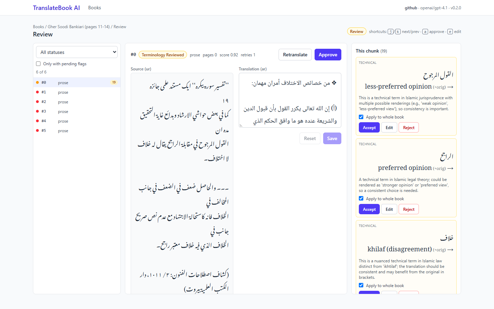
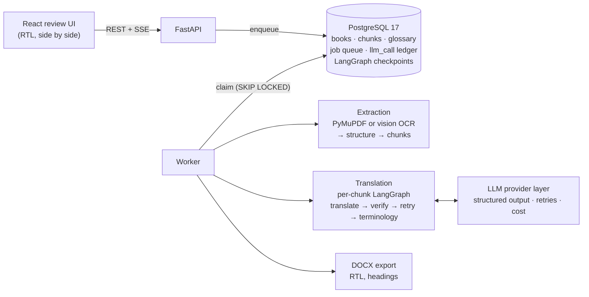

<div align="center">

# ترجمة · TranslateBook AI

### Translate whole scanned books between Urdu and Arabic, with a scholar in the loop.

Structure-aware chunking · a verify-and-retry agent per chunk · terminology decided once, applied everywhere · crash-safe jobs

[](https://github.com/Hassan-Memon/ai-book-translator/actions/workflows/ci.yml)
[](https://python.org)
[](https://fastapi.tiangolo.com)
[](https://langchain-ai.github.io/langgraph/)
[](https://postgresql.org)
[](https://react.dev)
[](LICENSE)



<sub>The review screen on a real run: a <b>scanned</b> Urdu page (vision OCR) → Arabic translation (verifier score 0.92) → 19 terminology flags.<br>
Those flags show English glosses: that was prompt v2, caught on exactly this run and fixed in <a href="prompts/terminology.md">v3</a> ("never an English gloss").</sub>

</div>

---

## Why this exists

Many classical Islamic texts exist only as **scanned PDFs**, and the scholarship moves between Urdu and Arabic. Generic machine translation breaks on these books in predictable ways:

| What goes wrong | What TranslateBook AI does |
|---|---|
| Headings, footnotes and quotations collapse into one blob | Maps structure first, then cuts **semantic chunks** (a heading always starts a chunk) |
| One technical term gets rendered five different ways across 300 pages | Flags terms for a **human decision once**; "apply to whole book" writes the glossary that goes into every later prompt |
| Quranic verses get "translated" | Quranic text is **passed through untouched**, never machine-translated |
| Confident but wrong output, no second opinion | A **verifier** scores every chunk and gives span-level fixes; below the threshold the translator retries using that feedback |
| A crash at page 180 means starting over | **Crash-safe**: a Postgres job queue plus LangGraph checkpoints. A killed worker resumes at the exact step it died in |

I'm an AI engineer and also trained in Arabic and Islamic scholarship, so I know these failure modes as a reader first. That's why this project exists.

## What's interesting under the hood

**1. One LangGraph per chunk, checkpointed in Postgres.**

```
prepare → translate → verify ─┬─ score ≥ 0.8 → terminology → END
              ▲               └─ low score → retry with the verifier's notes ─┐
              └───────────────────────────────────────────────────────────────┘
```
Every node's output is a typed Pydantic model (a parse failure is an error, never a silent `json.loads`). The checkpointer saves state after each node under `thread_id = book:chunk`, so a failure in `verify` never pays for `translate` again. → [`agents/chunk_graph.py`](backend/app/agents/chunk_graph.py)

**2. A job queue that is just a Postgres table.** `FOR UPDATE SKIP LOCKED` claims, heartbeats, exponential backoff, and stale-lock reclaim. No Redis, no Celery, one database to inspect. The reasoning is in [ADR-0002](docs/adr/0002-postgres-as-job-queue.md). → [`jobs/queue.py`](backend/app/jobs/queue.py)

**3. A test that actually kills the worker.** [`test_kill_resume.py`](backend/tests/test_kill_resume.py) starts a real worker process and hard-kills it *inside* a chunk's `verify` call. It then starts a new worker and asserts three things: the job succeeds, every chunk was translated **exactly once**, and the log says `resuming at ('verify',)`. It runs in CI on every push.

**4. Every LLM call is on the ledger.** Node, model, prompt version, tokens, latency and cost go into an `llm_call` row. The UI shows cost per book and per model. Prompts are versioned markdown files with changelogs ([`prompts/`](prompts/)).

**5. Live progress without polling.** Server-Sent Events (`GET /books/{id}/events`) push a snapshot only when something changes, then close when the book is idle.

**6. Provider-agnostic.** GitHub Models, OpenAI, Anthropic, NVIDIA, Ollama, or a deterministic **fake provider** that lets the whole app and test suite run offline for free.



## Honest status

| ✅ Works today | 🔨 Next | ❌ Not yet |
|---|---|---|
| Upload a text or **scanned** PDF → background extraction (vision-LLM OCR) | **Evaluation harness**: a golden set written by a human scholar + an LLM judge, with model × prompt comparison tables ([plan](docs/EVALUATION.md)) | A public demo deployment |
| Per-chunk translate → verify → retry → terminology, typed outputs | Embedding-based glossary search (trigram today) | PDF export with RTL layout |
| Crash-safe jobs + mid-chunk resume, proven by a kill test in CI | Structured logs with correlation ids | Auth / multiple reviewers |
| Review UI: edit, approve, accept suggestions, decide terms for the whole book | | |
| DOCX export · cost ledger · live progress over SSE | | |
| 25 tests on a real Postgres (unit, integration, e2e kill test) · ruff · CI | | |

**What I can't claim yet:** a measured translation-quality number. A single verifier score of 0.92 is not an evaluation, so the evaluation harness is the next milestone, and its results table will go here.

## Run it in 3 minutes

You need Python 3.12+, [uv](https://docs.astral.sh/uv/), Node 22+ and Docker. **No API key needed**: without one the app runs a fake translator so you can click through the whole flow.

```bash
git clone https://github.com/Hassan-Memon/ai-book-translator.git && cd ai-book-translator
cp .env.example .env              # optional: add GITHUB_TOKEN (GitHub Models has a free tier)
docker compose up -d db           # Postgres on localhost:5433

cd backend && uv sync && uv run alembic upgrade head && cd ..
cd frontend && npm install && npm run build && cd ..
make api                          # → http://127.0.0.1:8010 (the API also runs the worker)
```

Tests: `cd backend && uv run pytest -q` · Lint: `uv run ruff check app tests` · Full stack in Docker: `docker compose --profile full up --build`

<details>
<summary>More: dev server, CLI, Windows note, project layout</summary>

- Frontend dev: `make dev` (Vite on :5173, proxies `/api` to :8010)
- Standalone worker: `make worker`
- CLI: `cd backend && uv run translatebook --help`
- Windows: async psycopg (used by the checkpointer) needs a selector event loop, so start uvicorn with `--loop app.core.eventloop:new_event_loop`. `make api` already does this.
- API contract: [docs/API.md](docs/API.md)

```
backend/app/
  api/routes.py          thin HTTP handlers
  services/              use-cases shared by API, worker and CLI
  agents/                chunk_graph.py (LangGraph), checkpoint.py, schemas.py (typed LLM outputs)
  jobs/                  Postgres queue + handlers;  worker.py claims and runs jobs
  llm/                   provider layer, versioned prompt loader, pricing, call recorder
  pipeline/              extractor (text + OCR ladder), format mapper, chunker, DOCX exporter
backend/tests/           fake-LLM unit tests, integration on real Postgres, e2e kill test
frontend/                React 19 + Vite + TypeScript + Tailwind
prompts/                 versioned prompt files with changelogs
docs/                    API contract, ADRs, evaluation plan
```
</details>

## How it's built

This is a solo project. Every debatable choice gets an [architecture decision record](docs/adr/), the API contract is in [docs/API.md](docs/API.md), and the [evaluation plan](docs/EVALUATION.md) is written before the harness. I use AI coding assistants (Claude Code) heavily, and I review, test and own every change.

Bugs the tests caught and are now pinned by regression tests: an `AsyncSession` shared across concurrent tasks, a chunker that duplicated the previous chunk into every next one, and stale page numbers after a split.

## About me

**Hassan Memon**: AI engineer in Karachi, Pakistan, and trained in Arabic/Urdu Islamic scholarship. I build LLM systems that hold up in production: agent workflows, evaluation, durable pipelines and the boring parts that make them reliable.

**I'm open to remote AI / backend engineering roles.** If you're hiring, or you're an engineer who wants to pick apart a design decision here, I'd like to hear from you.

[LinkedIn](https://www.linkedin.com/in/hassan-memon-a109b3257/) · [GitHub](https://github.com/Hassan-Memon) · hassan.ghaddai@live.com
