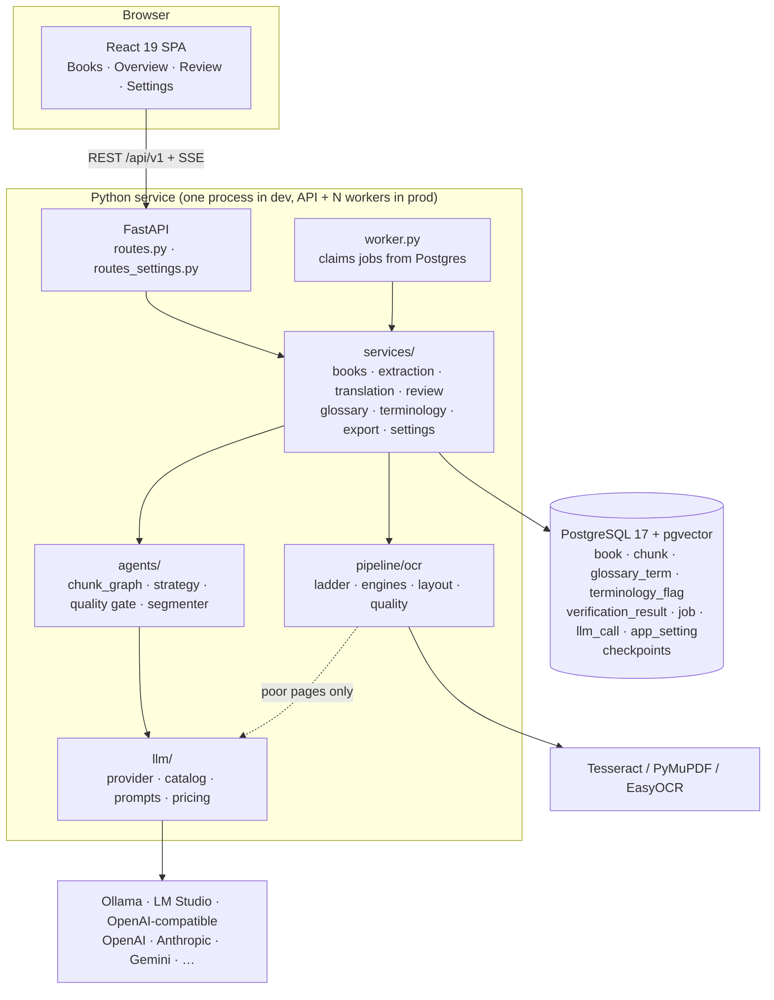

# Architecture

TranslateBook AI is one Python service (FastAPI API plus job worker), one PostgreSQL database and a React single-page app served by the same process. Everything else (OCR engines, model servers, cloud APIs) is optional and pluggable.

## Request and job flow

1. **Upload**: `POST /books` stores the PDF once (de-duplicated by sha256), creates the `book` row and enqueues an `extraction` job. `POST /books/sniff` can run first; it inspects the PDF without storing anything.
2. **Worker**: `worker.py` claims the oldest queued job with `FOR UPDATE SKIP LOCKED`, heartbeats while running, and re-queues with exponential backoff on failure (ADR-0002). In development the worker runs inside the API process (`WORKER_INLINE=true`).
3. **Extraction** (`services/extraction.py`): for each page, the text layer or the OCR ladder produces line blocks with geometry; then the format mapper detects headings, bold, alignment and content class; then the semantic chunker cuts chunks (a heading always starts a chunk). Each chunk stores its OCR quality and engine.
4. **Translation** (`services/translation.py`): the strategy is resolved from the model and the book's overrides, the per-chunk LangGraph is compiled once, and chunks run with bounded concurrency. Each chunk run loads its neighbours, the glossary and the translation-memory examples in its own session, runs the graph, then persists the translation, verification and terminology flags.
5. **Review**: the UI reads chunks, applies edits, accepts or rejects suggestions and decides flags. A flag decided with "apply to whole book" becomes a glossary term.
6. **Export**: an `export` job writes the DOCX. `GET /books/{id}/export/download` serves the latest one.
7. **Live progress**: `GET /books/{id}/events` streams a snapshot over Server-Sent Events whenever something changes and closes when the book is idle.

## Data model

| Table | Holds |
|---|---|
| `book` | Title, author, language pair, status, counts, `domain`, `instructions`, per-book `settings`, `ocr_summary` |
| `chunk` | `raw_text`, `translated_text`, `format_map` (per-line structure), content type, status, pages, reviewer score, `ocr_quality`, `ocr_engine`, `source_clean` |
| `verification_result` | Score, summary and span-level suggestions per attempt, each with an accept or reject status |
| `terminology_flag` | Term, suggested rendering, category, rationale, human decision |
| `glossary_term` | Decided renderings per book (trigram index; nullable pgvector embedding) |
| `job` | The queue: kind, status, payload, result, progress, attempts, lock and heartbeat |
| `llm_call` | The ledger: node, provider, model, prompt version, tokens, cost, latency, status |
| `app_setting` | Settings saved from the UI, with encrypted API keys |
| `checkpoints*` | LangGraph checkpoints for in-flight chunks |

Chunk lifecycle: `extracted → terminology_reviewed → approved`, with `failed` on error. Book lifecycle: `uploaded → extracting → extracted → translating → review → done`, or `failed`.

## Module map

| Path | Responsibility |
|---|---|
| `app/api/` | Thin HTTP handlers: validate, call a service, shape the response |
| `app/services/` | Use-cases shared by the API, worker and CLI |
| `app/jobs/` | The Postgres queue, and `handlers.py` which maps job kinds to services and builds the provider |
| `app/pipeline/` | `extractor.py`, `ocr/`, `format_mapper.py`, `chunker.py`, `exporter_docx.py` |
| `app/agents/` | `chunk_graph.py`, `strategy.py`, `quality.py`, `segmenter.py`, `schemas.py`, `checkpoint.py` |
| `app/llm/` | `provider.py` (clients, parsing, retries, ledger), `catalog.py` (providers, tiers, local models), `prompts.py`, `pricing.py` |
| `app/core/` | `config.py`, `languages.py` (the registry), `secrets.py`, `database.py`, `eventloop.py`, `logging.py` |
| `app/models/`, `app/schemas/` | SQLAlchemy models; Pydantic request and response shapes |
| `app/evals/` | The evaluation harness: golden sets, chrF++, term adherence, structure, judge, runner ([EVALUATION.md](EVALUATION.md)) |
| `app/cli.py` | `translatebook upload / translate / export / books / worker / serve / eval` |
| `frontend/functions/`, `deploy/cloudflare/` | Cloudflare Pages Functions (site password, `/api` proxy) and the tunnel script ([CLOUDFLARE.md](CLOUDFLARE.md)) |
| `frontend/src/` | `pages/` (Books, BookOverview, Review, Settings), `components/` (ui kit, layout, toasts), `lib/` (lang, fonts, theme), `api/` (client, types, SSE) |
| `prompts/` | Versioned prompt files (ADR-0003) |

## Design principles

- **One database.** The queue, the ledger, settings and checkpoints all live in Postgres, so a backup and `psql` cover everything.
- **Deterministic before generative.** OCR layout, the quality gate, glossary adherence and sentence alignment are code, not prompts. The LLM is spent on the judgement only it can make.
- **Fail loudly.** A parse failure is an error (ADR-0005). An untranslated chunk is exported with a marker, never dropped.
- **Everything is resumable.** Jobs re-queue, and chunks resume at the failed node (ADR-0006).
- **Every decision has a record** in [`docs/adr/`](adr/).
